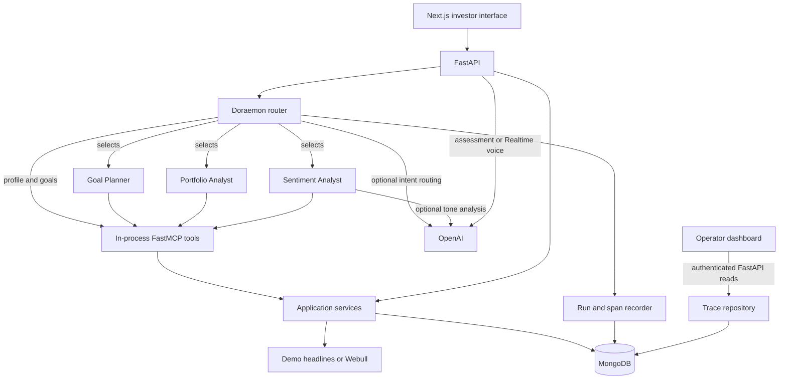

# Integrate the investor demo

The Next.js frontend, FastAPI backend and FastMCP agents share one MongoDB portfolio. A fresh install opens with Nobita’s THB 500,000 fully invested across seven holdings. Goal savings and monthly contributions are separate planning inputs.

## Start from a fresh checkout

Install Docker with Compose, clone the repository and run the following from its root. If you already have a local `.env`, add the shared-demo settings from the example to that file.

```sh
cp -n .env.example .env
docker compose up -d --build --wait
docker compose exec -T api python -m app.data.seed_future_you_demo
```

The seed creates the synthetic profile, four goals, emergency reserve, market snapshot and opening account. Running it again preserves saved trades and goal edits. Compose keeps the database in its project’s `mongo_data` volume between restarts. Once images exist, use `docker compose up -d --wait` to run the same checkout again.

Open [Portfolio](http://localhost:3113/), [Investing Behavior Score](http://localhost:3113/behavior) or [FastAPI docs](http://localhost:8113/docs). To verify the data from another client, call the portfolio endpoint. With a fresh account, expect `value_thb` of 500000, `cash_thb` of 0 and seven entries in `holdings`.

```sh
curl -fsS http://localhost:8113/api/v1/demo/portfolio
```

| Symbol | Opening value (THB) | Weight |
| --- | ---: | ---: |
| VOO | 175,000 | 35% |
| NVDA | 75,000 | 15% |
| SGOV | 75,000 | 15% |
| VT | 50,000 | 10% |
| SE | 50,000 | 10% |
| GLD | 50,000 | 10% |
| BTC | 25,000 | 5% |

The ledger holds fractional opening quantities at the demo exchange rate of THB 35/USD. On first launch, cash is zero. A simulated sale releases cash for subsequent buys.

## Restore the published database snapshot

The [seed directory](seed/) contains newline-delimited MongoDB Extended JSON exported from a freshly seeded, isolated database. It contains one market and health snapshot, one opening ledger with empty fills, and six profile and planning documents. Dates and ObjectIds retain their MongoDB types.

For an exact restore, start MongoDB and import into an **empty** database before starting the API. From the repository root, with the example settings, run the following **instead of** the Python seed step. If you choose another database name, use it for both `MONGODB_DATABASE` in `.env` and `--db` below.

```sh
docker compose up -d --wait mongo
for collection in future_you_demo demo_snapshots paper_accounts; do
  docker compose exec -T mongo mongoimport \
    --db prik_thai_dev --collection "$collection" --mode=insert --stopOnError \
    < "database/seed/$collection.jsonl" || break
done
```

Confirm the import reports 6, 1 and 1 documents respectively, then run `docker compose up -d --build --wait` and the portfolio check above. For an existing demo, use the repeatable Python seed command. New trades, journal entries and operator traces are created by using the app.

## How the components connect



FastMCP runs inside the API process. Each agent has its own tool allowlist. The [operator dashboard](http://localhost:3113/ops/agents) includes an interactive system map and execution traces for individual runs. To enable sign-in, set `AGENT_OPS_SECRET` in the local `.env` to a secret of at least 24 characters and recreate the API with `docker compose up -d --no-deps api`.

The default setup supports offline companion routing and synthetic quotes. Set `OPENAI_API_KEY` and `OPENAI_COMPANION_MODEL` on the API for model-backed routing, sentiment analysis and the on-demand behavior assessment. For Future Talk voice, also set `FUTURE_YOU_VOICE_ENABLED=1`. Apply API configuration changes with the same Compose command. See the [agent operations contract](../docs/contracts/agent-operations.md) for tools and authorization.
